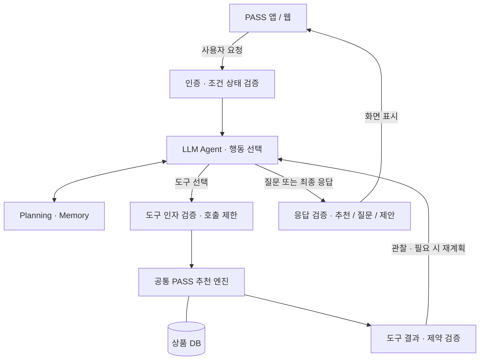
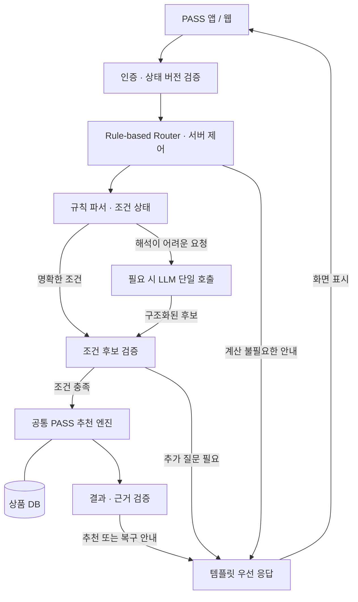

# PASS — Personalized AI Shopping System

Expo / React Native 기반 iOS·Android 선물 추천 앱입니다. 웹에서도 같은 모바일 화면과 서비스를 사용합니다.

[PASS 웹 앱](https://temporary-prompt-sable-s15js3l.vercel.app) · [추천 API 상태](https://pass-recommendation-api.a73342776.workers.dev/health)

[실행 가이드](docs/getting-started.md) · [프로젝트 구조](docs/project-structure.md) · [배포 가이드](docs/deployment.md)

## 아키텍처

[현재 운영 구조와 배포 설정](docs/architecture.md) · [구조도](https://temporary-prompt-sable-s15js3l.vercel.app/architecture.svg)

### 1안: LLM Agent

**아래는 구현 예정인 설계입니다.** 현재 API의 LLM은 조건 추출을 담당하며, 아래의 도구 선택·반복 실행·재계획 루프는 아직 구현하지 않았습니다.

LLM Agent는 요청이 들어오면 필요한 질문·도구·종료 시점을 선택합니다. 상품 필터·정렬·가격 계산·예산 비교는 공통 PASS 엔진이 수행하고, 서버가 조건 변경과 도구 결과를 검증합니다. 추천뿐 아니라 조건 수정·추천 이유 설명·가상 예산 비교도 에이전트의 처리 대상입니다.



가상 예산 비교는 실제 조건을 바꾸지 않습니다. 예산·제외 조건 완화 제안은 사용자가 명시적으로 적용한 뒤 상태 버전을 확인해 반영합니다. 이미 명확하게 요청한 일반 조건 수정은 검증 후 반영하며, 대기 중에는 에이전트를 실행하지 않습니다.

[LLM Agent 설계 README](docs/llm-agent/README.md) · [구조도 Mermaid 원본](docs/llm-agent/architecture.mmd)

### 2안: Rule-based Hybrid

**아래는 목표 구조이며, 규칙 우선 Router의 초기 구현은 [`baseline/agents/a-router/`](baseline/agents/a-router/README.md)에 있습니다. 로컬 API는 기본으로 이 구현을 사용하며 운영 서버 배포는 별도입니다.** 백엔드 Router가 요청 분류·함수 호출·종료를 결정합니다. 명확한 요청은 규칙 파서와 공통 PASS 엔진으로 처리하고, 해석이 어려운 요청에만 LLM을 제한적으로 호출합니다. LLM은 조건 후보를 반환하며 도구를 선택하거나 재계획 루프를 실행하지 않습니다.



예산 비교·추천 근거는 1안과 같은 엔진 결과를 사용합니다. 템플릿을 우선 사용하고, 복잡한 설명에 LLM이 필요하면 서버가 정한 별도 단일 생성 단계로 호출한 뒤 근거를 검증합니다. 조건을 확정할 수 없으면 추정하지 않고 질문하며, 가상 비교와 변경 제안의 사용자 확인 정책도 1안과 같습니다.

[Hybrid 설계 README](docs/rule-based-hybrid/README.md) · [구조도 Mermaid 원본](docs/rule-based-hybrid/architecture.mmd)

### 두 안의 비교 기준

| 구분 | 1안: LLM Agent | 2안: Rule-based Hybrid |
| --- | --- | --- |
| 다음 행동·도구 선택 | LLM | 백엔드 규칙 |
| LLM 사용 | 해석·행동 선택·응답 생성 | 필요한 해석·설명에 제한적 호출 |
| 재계획 | 제한된 에이전트 루프 | 서버가 정의한 질문·실패 복구 정책 |
| 추천·정렬·금액·예산 비교 | 공통 PASS 엔진 | 동일 PASS 엔진 |
| 응답 | 근거 기반 LLM 생성 | 템플릿 우선 |

비교의 핵심은 **LLM 호출 유무가 아니라 실행 제어 주체**입니다. 두 안은 같은 상품 DB·조건 검증·추천 엔진·예산 비교 기능을 공유하는 것을 목표로 합니다. LLM Agent 모드와 두 안의 비교 실험은 아직 구현하지 않았으며, 비용·속도·정확도·설명 이해도 차이는 구현 후 측정합니다.

## 수령인별 기억과 구매 이력

AI 추천 화면의 `기억과 구매 이력 관리`에서 수령인의 선호·제외 조건을 명시적으로 저장하고, 실제 구매했다고 직접 등록한 상품에 만족도를 남길 수 있습니다. 같은 수령인을 위한 새 대화에서 기억과 긍정 구매 피드백을 반영합니다. 현재는 기기 내 계정별 저장이며 실제 주문 확인이나 기기 간 동기화는 제공하지 않습니다. [동작·저장 범위·검증 시나리오](docs/personalization.md)를 참고하세요.

## 에이전트 공통 베이스라인

다섯 아키텍처가 공유하는 실행 가능한 추천 코어는 [`baseline/`](baseline/README.md)에 있다. 조건·세션·버전 검증, 질문, 고정 PASS 엔진, 원본 상태를 바꾸지 않는 예산 비교, 결과 제약 검증과 템플릿 응답을 제공한다. `a-router`는 설정으로 현재 앱 API에 연결했고 다른 에이전트의 연결은 후속 작업이며, 각 아키텍처는 같은 공통 코어에서 확장한다.

```sh
npm --prefix baseline test
npm --prefix baseline run demo
```

[다섯 설계의 공통 범위와 확장 경계](baseline/docs/common-scope.md) · [현재 프로토타입 PRD](PRD.md)

이전 버전·연구 자료·과거 평가 산출물은 정리했다. 음성인식, 카메라·앨범·파일 선택, 로그인과 개인화 구현은 유지한다. 첨부 기능은 파일명 표시까지이며 실제 서버 업로드·내용 분석은 아직 제공하지 않는다.

## 플랫폼 LLM 시험

A안 Router는 OpenAI 호환 플랫폼의 `deepseek-v4-flash`를 지원한다. 서버 `api/.dev.vars`에 플랫폼 키를 설정하고 `npm run smoke:llm`으로 실제 연결을 시험한다. 명확한 조건은 규칙으로 처리하고 모호한 발화에만 모델을 호출한다. [설정 및 실제 시험 결과](docs/llm-platform.md).
