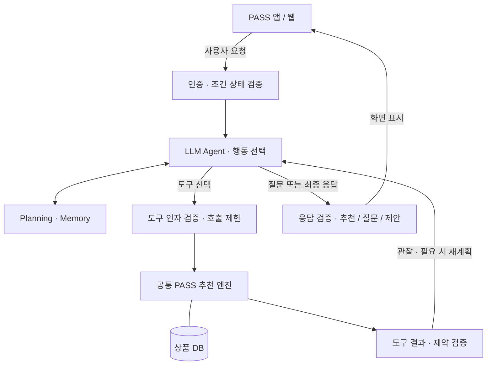
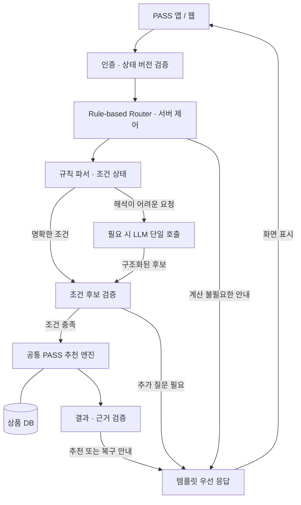

# PASS — Personalized AI Shopping System

## 아키텍처

아래는 프로젝트의 초기 설계와 구조도입니다. 본실험에서 실행한 A·B·C는 [실험 방법](#실험-방법)에 정리했습니다.

[현재 운영 구조와 배포 설정](docs/architecture.md) · [구조도](https://temporary-prompt-sable-s15js3l.vercel.app/architecture.svg)

### 1안: LLM Agent

**아래는 구현 예정인 설계입니다.** 현재 API의 LLM은 조건 추출을 담당하며, 아래의 도구 선택·반복 실행·재계획 루프는 아직 구현하지 않았습니다.

LLM Agent는 요청이 들어오면 필요한 질문·도구·종료 시점을 선택합니다. 상품 필터·정렬·가격 계산·예산 비교는 공통 PASS 엔진이 수행하고, 서버가 조건 변경과 도구 결과를 검증합니다. 추천뿐 아니라 조건 수정·추천 이유 설명·가상 예산 비교도 에이전트의 처리 대상입니다.



가상 예산 비교는 실제 조건을 바꾸지 않습니다. 예산·제외 조건 완화 제안은 사용자가 명시적으로 적용한 뒤 상태 버전을 확인해 반영합니다. 이미 명확하게 요청한 일반 조건 수정은 검증 후 반영하며, 대기 중에는 에이전트를 실행하지 않습니다.

[LLM Agent 설계 README](docs/llm-agent/README.md) · [구조도 Mermaid 원본](docs/llm-agent/architecture.mmd)

### 2안: Rule-based Hybrid

**아래는 목표 구조이며, 규칙 우선 Router의 초기 구현은 [`baseline/agents/a-router/`](baseline/agents/a-router/README.md)에 있습니다. 로컬 API는 기본으로 이 구현을 사용하며 운영 서버 배포는 별도입니다.** 백엔드 Router가 요청 분류·함수 호출·종료를 결정합니다. 명확한 요청은 규칙 파서와 공통 PASS 엔진으로 처리하고, 해석이 어려운 요청에만 LLM을 제한적으로 호출합니다. LLM은 조건 후보를 반환하며 도구를 선택하거나 재계획 루프를 실행하지 않습니다.



예산 비교·추천 근거는 1안과 같은 엔진 결과를 사용합니다. 템플릿을 우선 사용하고, 복잡한 설명에 LLM이 필요하면 서버가 정한 별도 단일 생성 단계로 호출한 뒤 근거를 검증합니다. 조건을 확정할 수 없으면 추정하지 않고 질문하며, 가상 비교와 변경 제안의 사용자 확인 정책도 1안과 같습니다.

[Hybrid 설계 README](docs/rule-based-hybrid/README.md) · [구조도 Mermaid 원본](docs/rule-based-hybrid/architecture.mmd)

### 두 안의 비교 기준

| 구분 | 1안: LLM Agent | 2안: Rule-based Hybrid |
| --- | --- | --- |
| 다음 행동·도구 선택 | LLM | 백엔드 규칙 |
| LLM 사용 | 해석·행동 선택·응답 생성 | 필요한 해석·설명에 제한적 호출 |
| 재계획 | 제한된 에이전트 루프 | 서버가 정의한 질문·실패 복구 정책 |
| 추천·정렬·금액·예산 비교 | 공통 PASS 엔진 | 동일 PASS 엔진 |
| 응답 | 근거 기반 LLM 생성 | 템플릿 우선 |

비교의 핵심은 **LLM 호출 유무가 아니라 실행 제어 주체**입니다. 두 안은 같은 상품 DB·조건 검증·추천 엔진·예산 비교 기능을 공유하는 것을 목표로 합니다. LLM Agent 모드와 두 안의 비교 실험은 아직 구현하지 않았으며, 비용·속도·정확도·설명 이해도 차이는 구현 후 측정합니다.

## 실험 방법

### 데이터와 시나리오

- Amazon 영문 상품명은 원문을 사용했다. 유효한 ASIN을 중복 제거한 뒤 원본 대분류 비율에 맞춰 **300,000개**를 선택했다. 고정 시드는 `pass-amazon-en-v1`이다. 가격·배송·재고 조건에는 실험용 합성값을 사용했다. [데이터 출처](https://www.kaggle.com/datasets/lokeshparab/amazon-products-dataset)
- 정확 상품 검색, 일반 추천, 알레르기 제외, 다중 턴 대화를 **각 30개**, 총 **120개**의 한국어 시나리오로 구성했다. 같은 모델·모드에서 각 시나리오를 3회 반복해 **360회**, 다중 턴을 포함해 **API 요청 450건**을 집계했다. [고정 시나리오](api/benchmarks/amazon-en/fixtures.mjs)
- 실제 PASS Worker 채팅 경로를 합성 인증·세션과 로컬 카탈로그로 실행했다. API p50·p95에는 Worker 처리 시간과 모델 왕복 시간이 포함된다. 최종 C와 A·B는 별도 세션에서 측정했다.

### 비교 모드

| 모드 | 실행 방식 |
|---|---|
| A · 규칙 우선 | 규칙으로 조건을 적용하고, 해석이 필요한 요청만 모델에 보낸다. |
| B · 풀 에이전트 | 모델이 조건 변경이나 조회 등의 다음 행동을 선택하고, 공통 엔진이 결과를 검증한다. |
| C · 피드백 에이전트 | 필요한 행동을 검토하고, 최종 응답에서 요청 조건과 상품 근거를 순서대로 검증한다. |

모든 모드는 같은 카탈로그와 채점 기준을 사용했다. 정확 상품은 확인 질문 없이 반환된 첫 카드(Top 1)와 상위 세 카드(Top 3)의 ASIN으로 판정했다. 일반 추천은 적용된 예산·배송·상품군 등 조건에 맞는 카드가 하나 이상 있고 확인 질문 없이 응답했을 때 성공으로 집계했다. 다중 턴 전체 성공은 지원 범위에 있는 72건에서 모든 턴의 성공을 뜻한다. 알레르기는 명시 성분 저장과 성분 미상 확인 질문·카드 보류를 각각 집계했다. [채점 코드](api/benchmarks/amazon-en/scoring.mjs)

### 재현

저장소 루트에서 Python 3.11 이상과 Node.js 22.13 이상을 사용한다. 두 `--mode ABC` 명령은 실제 모델을 호출한다. [데이터 준비 및 서버 설정](api/benchmarks/amazon-en/README.md)

```sh
python3 api/benchmarks/amazon-en/prepare.py data/amazon-products-dataset.zip data/amazon-en/catalog
node api/benchmarks/amazon-en/run.mjs --validate
node api/benchmarks/amazon-en/run.mjs --mode ABC --model deepseek-v4-flash --data data/amazon-en/deepseek-abc
node api/benchmarks/amazon-en/run.mjs --mode ABC --model gpt-5.6-luna --data data/amazon-en/gpt-abc
```

## 회귀 평가 결과

아래 표는 개발 중 개선에 사용한 고정 120개 시나리오를 다시 평가한 결과다. 세 번의 반복은 동일 문장의 응답 일관성을 측정한다. 미공개 문장과 상품을 사용한 일반화 성능은 별도 평가에서 확인한다. [비공개 평가 방법](api/benchmarks/amazon-en/README.md#비공개-평가)

### DeepSeek V4 Flash A·B·C

| 지표 | A | B | C |
|---|---:|---:|---:|
| 정확 상품 Top 1 / Top 3 | 3/90 · 3/90 | 27/90 · 27/90 | 60/90 · 60/90 |
| 일반 추천 성공 | 90/90 | 90/90 | 90/90 |
| 다중 턴 전체 성공 | 72/72 | 72/72 | 72/72 |
| 명시한 알레르기 성분 저장 | 54/63 | 63/63 | 63/63 |
| 성분 미상일 때 확인 질문 | 27/27 | 27/27 | 27/27 |
| 성분 미상일 때 추천 카드 반환 | 0/27 | 0/27 | 0/27 |
| API 응답 시간 p50 / p95 | 0.66초 / 4.51초 | 1.51초 / 4.48초 | 2.30초 / 7.33초 |
| HTTP 오류 | 0/450 | 0/450 | 0/450 |
| 모델 호출 | 162 | 405 | 1019 |
| 추정 비용 | $0.008705 | $0.044292 | $0.052869 (확인분) |

### GPT-5.6 Luna A·B·C

| 지표 | A | B | C |
|---|---:|---:|---:|
| 정확 상품 Top 1 / Top 3 | 3/90 · 3/90 | 27/90 · 27/90 | 60/90 · 60/90 |
| 일반 추천 성공 | 90/90 | 90/90 | 90/90 |
| 다중 턴 전체 성공 | 72/72 | 72/72 | 72/72 |
| 명시한 알레르기 성분 저장 | 51/63 | 54/63 | 58/63 |
| 성분 미상일 때 확인 질문 | 27/27 | 27/27 | 27/27 |
| 성분 미상일 때 추천 카드 반환 | 0/27 | 0/27 | 0/27 |
| API 응답 시간 p50 / p95 | 0.69초 / 4.74초 | 1.80초 / 4.75초 | 2.71초 / 7.57초 |
| HTTP 오류 | 1/450 | 0/450 | 0/450 |
| 모델 호출 | 162 | 405 | 1020 |
| 추정 비용 | $0.030501 | $0.149942 | $0.184559 |

비용은 사용자 제공 요율을 적용했다. 백만 토큰당 DeepSeek는 입력 $0.06·출력 $0.17, GPT는 입력 $0.20·출력 $1.20이다. DeepSeek C의 비용 확인분에는 사용량을 받지 못한 검증 호출 1건이 빠져 있다.

[최종 표와 원본 실행 기록](docs/verification/c-result-audit-2026-11-24/abc-results.md)
