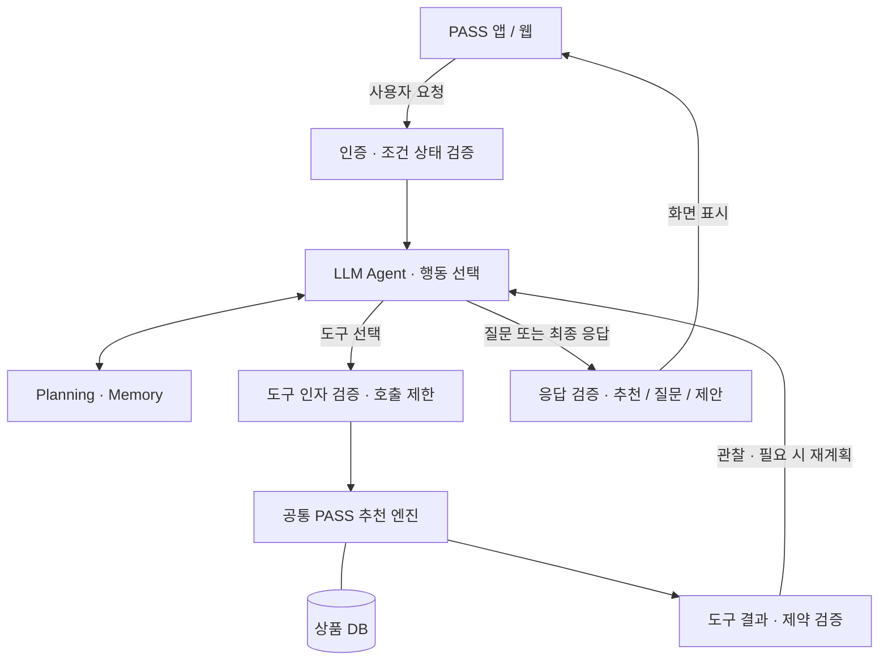

# PASS — Personalized AI Shopping System

Expo / React Native 기반 iOS·Android 선물 추천 앱입니다. 웹에서도 같은 모바일 화면과 서비스를 사용합니다.

[PASS 웹 앱](https://temporary-prompt-sable-s15js3l.vercel.app) · [추천 API 상태](https://pass-recommendation-api.a73342776.workers.dev/health)

[실행 가이드](docs/getting-started.md) · [프로젝트 구조](docs/project-structure.md) · [배포 가이드](docs/deployment.md)

## 아키텍처

[현재 운영 구조와 배포 설정](docs/architecture.md) · [구조도](https://temporary-prompt-sable-s15js3l.vercel.app/architecture.svg)

### LLM Agent 목표 구조

**아래는 구현 예정인 설계입니다.** 현재 API의 LLM은 조건 추출을 담당하며, 아래의 도구 선택·반복 실행·재계획 루프는 아직 구현하지 않았습니다.

LLM Agent는 요청이 들어오면 필요한 질문·도구·종료 시점을 선택합니다. 상품 필터·정렬·가격 계산·예산 비교는 공통 PASS 엔진이 수행하고, 서버가 조건 변경과 도구 결과를 검증합니다. 추천뿐 아니라 조건 수정·추천 이유 설명·가상 예산 비교도 에이전트의 처리 대상입니다.

가상 예산 비교는 실제 조건을 바꾸지 않습니다. 예산·제외 조건 완화 제안은 사용자가 명시적으로 적용한 뒤 상태 버전을 확인해 반영합니다. 이미 명확하게 요청한 일반 조건 수정은 검증 후 반영하며, 대기 중에는 에이전트를 실행하지 않습니다.

[LLM Agent 설계 README](docs/llm-agent/README.md) · [구조도 Mermaid 원본](docs/llm-agent/architecture.mmd)

후속 목표는 **같은 상품 DB·조건·추천 엔진을 공유하는 LLM Agent와 Rule-based Hybrid의 비교**입니다. 차이는 LLM 호출 유무가 아니라 실행 제어 주체이며, Hybrid는 백엔드가 흐름을 제어하고 필요할 때만 LLM을 제한적으로 호출합니다. 우선 LLM Agent 설계를 문서화하며, 두 모드와 비교 실험은 아직 구현하지 않았습니다.

## 수령인별 기억과 구매 이력

AI 추천 화면의 `기억과 구매 이력 관리`에서 수령인의 선호·제외 조건을 명시적으로 저장하고, 실제 구매했다고 직접 등록한 상품에 만족도를 남길 수 있습니다. 같은 수령인을 위한 새 대화에서 기억과 긍정 구매 피드백을 반영합니다. 현재는 기기 내 계정별 저장이며 실제 주문 확인이나 기기 간 동기화는 제공하지 않습니다. [동작·저장 범위·검증 시나리오](docs/personalization.md)를 참고하세요.
