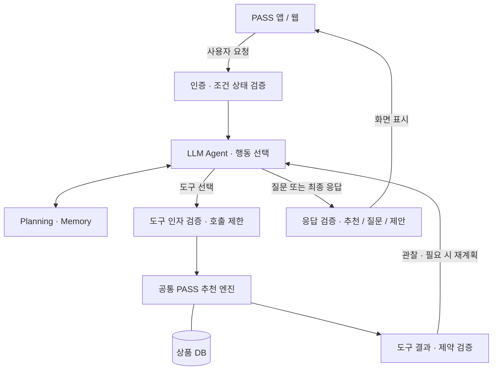
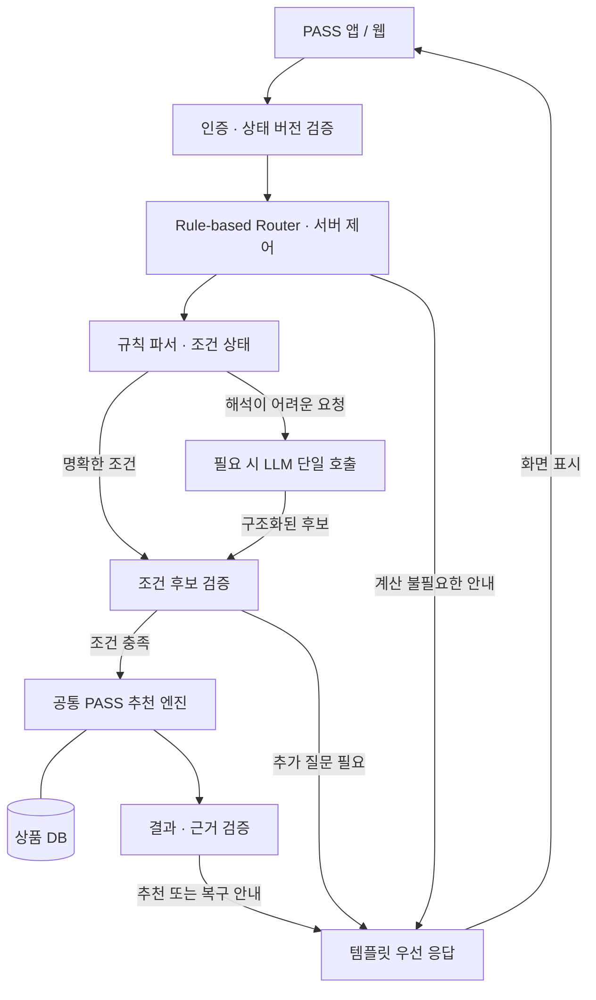

# PASS — Personalized AI Shopping System

Expo / React Native 기반 iOS·Android 선물 추천 앱입니다. 웹에서도 같은 모바일 화면과 서비스를 사용합니다.

[PASS 웹 앱](https://temporary-prompt-sable-s15js3l.vercel.app) · [추천 API 상태](https://pass-recommendation-api.a73342776.workers.dev/health)

[실행 가이드](docs/getting-started.md) · [프로젝트 구조](docs/project-structure.md) · [배포 가이드](docs/deployment.md)

## 아키텍처

[현재 운영 구조와 배포 설정](docs/architecture.md) · [구조도](https://temporary-prompt-sable-s15js3l.vercel.app/architecture.svg)

### 1안: LLM Agent

**아래는 구현 예정인 설계입니다.** 현재 API의 LLM은 조건 추출을 담당하며, 아래의 도구 선택·반복 실행·재계획 루프는 아직 구현하지 않았습니다.

LLM Agent는 요청이 들어오면 필요한 질문·도구·종료 시점을 선택합니다. 상품 필터·정렬·가격 계산·예산 비교는 공통 PASS 엔진이 수행하고, 서버가 조건 변경과 도구 결과를 검증합니다. 추천뿐 아니라 조건 수정·추천 이유 설명·가상 예산 비교도 에이전트의 처리 대상입니다.



가상 예산 비교는 실제 조건을 바꾸지 않습니다. 예산·제외 조건 완화 제안은 사용자가 명시적으로 적용한 뒤 상태 버전을 확인해 반영합니다. 이미 명확하게 요청한 일반 조건 수정은 검증 후 반영하며, 대기 중에는 에이전트를 실행하지 않습니다.

[LLM Agent 설계 README](docs/llm-agent/README.md) · [구조도 Mermaid 원본](docs/llm-agent/architecture.mmd)

### 2안: Rule-based Hybrid

**아래는 목표 구조이며, 규칙 우선 Router의 초기 구현은 [`baseline/agents/a-router/`](baseline/agents/a-router/README.md)에 있습니다. 로컬 API는 기본으로 이 구현을 사용하며 운영 서버 배포는 별도입니다.** 백엔드 Router가 요청 분류·함수 호출·종료를 결정합니다. 명확한 요청은 규칙 파서와 공통 PASS 엔진으로 처리하고, 해석이 어려운 요청에만 LLM을 제한적으로 호출합니다. LLM은 조건 후보를 반환하며 도구를 선택하거나 재계획 루프를 실행하지 않습니다.



예산 비교·추천 근거는 1안과 같은 엔진 결과를 사용합니다. 템플릿을 우선 사용하고, 복잡한 설명에 LLM이 필요하면 서버가 정한 별도 단일 생성 단계로 호출한 뒤 근거를 검증합니다. 조건을 확정할 수 없으면 추정하지 않고 질문하며, 가상 비교와 변경 제안의 사용자 확인 정책도 1안과 같습니다.

[Hybrid 설계 README](docs/rule-based-hybrid/README.md) · [구조도 Mermaid 원본](docs/rule-based-hybrid/architecture.mmd)

### 두 안의 비교 기준

| 구분 | 1안: LLM Agent | 2안: Rule-based Hybrid |
| --- | --- | --- |
| 다음 행동·도구 선택 | LLM | 백엔드 규칙 |
| LLM 사용 | 해석·행동 선택·응답 생성 | 필요한 해석·설명에 제한적 호출 |
| 재계획 | 제한된 에이전트 루프 | 서버가 정의한 질문·실패 복구 정책 |
| 추천·정렬·금액·예산 비교 | 공통 PASS 엔진 | 동일 PASS 엔진 |
| 응답 | 근거 기반 LLM 생성 | 템플릿 우선 |

비교의 핵심은 **LLM 호출 유무가 아니라 실행 제어 주체**입니다. 두 안은 같은 상품 DB·조건 검증·추천 엔진·예산 비교 기능을 공유하는 것을 목표로 합니다. LLM Agent 모드와 두 안의 비교 실험은 아직 구현하지 않았으며, 비용·속도·정확도·설명 이해도 차이는 구현 후 측정합니다.

## 수령인별 기억과 구매 이력

기존 수령인 기억과 구매 이력은 기기 내 계정별 기록으로 보존하며 분석에서만 별도로 조회합니다. AI 추천 화면에서는 이력 관리와 저장 기능을 숨겼으며 추천에는 현재 대화의 조건을 사용합니다. [보존 범위와 분석 경로](docs/personalization.md)를 참고하세요.

## 에이전트 공통 베이스라인

다섯 아키텍처가 공유하는 실행 가능한 추천 코어는 [`baseline/`](baseline/README.md)에 있다. 조건·세션·버전 검증, 질문, 고정 PASS 엔진, 원본 상태를 바꾸지 않는 예산 비교, 결과 제약 검증과 템플릿 응답을 제공한다. `a-router`는 설정으로 현재 앱 API에 연결했고 다른 에이전트의 연결은 후속 작업이며, 각 아키텍처는 같은 공통 코어에서 확장한다.

```sh
npm --prefix baseline test
npm --prefix baseline run demo
```

[다섯 설계의 공통 범위와 확장 경계](baseline/docs/common-scope.md) · [현재 프로토타입 PRD](PRD.md)

이전 버전·연구 자료·과거 평가 산출물은 정리했다. 음성인식, 카메라·앨범·파일 선택, 로그인과 개인화 구현은 유지한다. 첨부 기능은 파일명 표시까지이며 실제 서버 업로드·내용 분석은 아직 제공하지 않는다.

## 플랫폼 LLM 시험

A안 Router는 OpenAI 호환 플랫폼의 `deepseek-v4-flash`를 지원한다. 서버 `api/.dev.vars`에 플랫폼 키를 설정하고 `npm run smoke:llm`으로 실제 연결을 시험한다. 명확한 조건은 규칙으로 처리하고 모호한 발화에만 모델을 호출한다. [설정 및 실제 시험 결과](docs/llm-platform.md).

LLM 연결부만 공통으로 사용할 때는 [`baseline/llm/`](baseline/llm/README.md)를 가져오면 됩니다. 공통 main에는 이 독립 모듈만 추가했으며 Router·조건 추출 프롬프트는 각 에이전트에서 구성합니다.

A안의 Supervisor·전문 서브 에이전트·종합 판단 초기 구현을 추가했습니다. `A_ROUTER_LLM_MODE=subagents`로 시험하고, 설정을 생략하면 기존 `single`을 유지합니다. [실행·진단 안내](baseline/agents/a-router/README.md).

## PR 로컬 검토

Node 22.13 이상에서 저장소 루트의 `npm run setup` → `npm run setup:local` → `npm run dev:api` 순으로 실행합니다. 웹은 다른 터미널에서 `npm --prefix mobile run web -- --port 8766`으로 시작합니다. A 규칙 모드가 기본이며 서버 채팅은 Supabase 로그인이 필요합니다. C/D에는 서버 LLM 키가 추가로 필요합니다. B는 규칙과 자문을 실행하고, 서버 키가 있으면 어려운 귀속 판단에 모델을 사용합니다. 기존 환경 파일은 덮어쓰지 않습니다. [설정·포트·CORS·상태 확인 안내](api/README.md#로컬-시험)를 참고하세요.

## 상품 카탈로그 선택 (`CATALOG_SOURCE`)

A~D 네 모드는 모두 API가 한 번 불러온 같은 상품 목록을 쓴다. 이 목록은 `CATALOG_SOURCE`로 고른다. 기본값은 `amazon`이라 설정하지 않으면 지금과 같다.

| 값 | 상품 |
|---|---|
| `amazon`(기본) | Supabase의 아마존(Kaggle) 카탈로그 |
| `web` | 네이버 쇼핑에서 모은 한국 선물 카탈로그 `supabase/seed/products-kr.json`(명절·생일·수험·꽃, 590개) |
| `both` | 둘을 합친 목록(같은 상품만 중복 제거) |

웹 데모·실험에서 `web`을 켜는 방법은 둘 중 하나다.

- `api/.dev.vars`에 `CATALOG_SOURCE=web` 한 줄을 넣고 `npm run dev:api`
- 한 번만: `CATALOG_SOURCE=web npm run dev:api`

배포한 Worker에서는 `npx wrangler deploy --var CATALOG_SOURCE:web`(api 폴더)로 켠다.

앱의 선물 랭킹 화면과 게스트 채팅도 같은 카탈로그를 쓴다. 앱은 시작할 때 채팅 서버(`EXPO_PUBLIC_CHAT_API_URL`)의 `/health`에서 `catalog` 값을 읽어 따라가므로 서버 쪽 설정 하나만 바꾸면 된다. 서버에 닿지 않으면 `mobile/.env.local`의 `EXPO_PUBLIC_CATALOG_SOURCE`(기본 `amazon`)를 쓴다. `/health`의 `catalog` 값이 `naver-web-v1`이면 웹 카탈로그가 켜진 것이다. 웹 카탈로그 카드는 실제 상품 사진을 보여준다. 사진은 팀 공유용으로 `supabase/seed/images-kr/`에 커밋되어 있어 pull만 하면 뜨고, 채팅 서버가 `/catalog-images/<파일>`로 내려준다(로컬 API와 배포 Worker static assets 모두, 논문 캡처에는 사용하지 않음). 사진을 다시 준비할 때는 `node scripts/catalog/web/images.mjs`. 배송비는 네이버 목록의 기본 배송비이고, 도착일·재고·포장은 아마존 카탈로그와 같은 규칙으로 만든 데모 값이다. 품목 필터(`ITEM_FILTER=on`, 기본 `off`)를 켜면, 사용자가 말한 품목(예: "카네이션", "한우")의 상품이 3개 이상일 때 그 상품만 남긴 목록으로 A~D 모든 모드가 추천한다. 점수 계산과 LLM 호출은 그대로다.
- 대화 중 품목이 바뀌면 가장 최근에 말한 품목을 따른다. "카네이션 말고 장미"처럼 말고·빼고·제외가 붙은 품목은 쓰지 않는다.
- 한 글자 품목(배·김·꿀·떡·쌀)은 띄어 쓴 단어로만 인정한다. 그래서 배송·김치·떡볶이는 품목으로 읽지 않는다.
- 현재 품목은 응답의 `session.item_filter`에, 적용 결과는 `itemFilter`에 담긴다. 켜는 방법은 `CATALOG_SOURCE`와 같다(`api/.dev.vars` 또는 `ITEM_FILTER=on npm run dev:api`).

카탈로그 비교 결과는 [docs/catalog-kr/comparison.md](docs/catalog-kr/comparison.md), 수집 보고서는 [docs/catalog-kr/report.md](docs/catalog-kr/report.md)에 있다.
