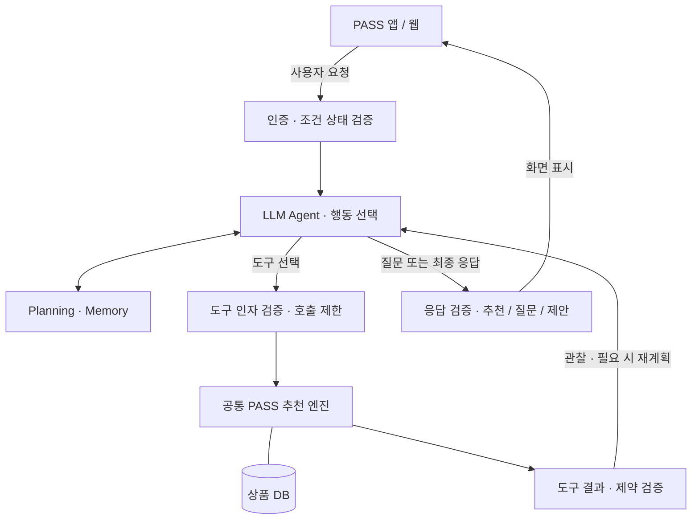
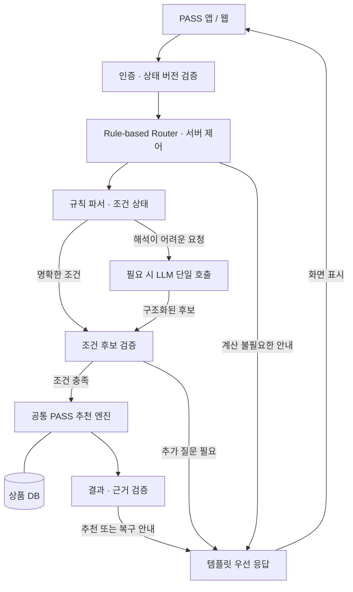

# PASS — Personalized AI Shopping System

## 아키텍처

아래는 프로젝트의 초기 설계와 구조도입니다. 본실험에서 실행한 A·B·C는 [실험 방법](#실험-방법)에 정리했습니다.

[현재 운영 구조와 배포 설정](docs/architecture.md) · [구조도](https://temporary-prompt-sable-s15js3l.vercel.app/architecture.svg)

### 1안: LLM Agent

**아래는 구현 예정인 설계입니다.** 현재 API의 LLM은 조건 추출을 담당하며, 아래의 도구 선택·반복 실행·재계획 루프는 아직 구현하지 않았습니다.

LLM Agent는 요청이 들어오면 필요한 질문·도구·종료 시점을 선택합니다. 상품 필터·정렬·가격 계산·예산 비교는 공통 PASS 엔진이 수행하고, 서버가 조건 변경과 도구 결과를 검증합니다. 추천뿐 아니라 조건 수정·추천 이유 설명·가상 예산 비교도 에이전트의 처리 대상입니다.

가상 예산 비교는 실제 조건을 바꾸지 않습니다. 예산·제외 조건 완화 제안은 사용자가 명시적으로 적용한 뒤 상태 버전을 확인해 반영합니다. 이미 명확하게 요청한 일반 조건 수정은 검증 후 반영하며, 대기 중에는 에이전트를 실행하지 않습니다.

[LLM Agent 설계 README](docs/llm-agent/README.md) · [구조도 Mermaid 원본](docs/llm-agent/architecture.mmd)

### 2안: Rule-based Hybrid

**아래는 목표 구조이며, 규칙 우선 Router의 초기 구현은 [`baseline/agents/a-router/`](baseline/agents/a-router/README.md)에 있습니다. 로컬 API는 기본으로 이 구현을 사용하며 운영 서버 배포는 별도입니다.** 백엔드 Router가 요청 분류·함수 호출·종료를 결정합니다. 명확한 요청은 규칙 파서와 공통 PASS 엔진으로 처리하고, 해석이 어려운 요청에만 LLM을 제한적으로 호출합니다. LLM은 조건 후보를 반환하며 도구를 선택하거나 재계획 루프를 실행하지 않습니다.

예산 비교·추천 근거는 1안과 같은 엔진 결과를 사용합니다. 템플릿을 우선 사용하고, 복잡한 설명에 LLM이 필요하면 서버가 정한 별도 단일 생성 단계로 호출한 뒤 근거를 검증합니다. 조건을 확정할 수 없으면 추정하지 않고 질문하며, 가상 비교와 변경 제안의 사용자 확인 정책도 1안과 같습니다.

[Hybrid 설계 README](docs/rule-based-hybrid/README.md) · [구조도 Mermaid 원본](docs/rule-based-hybrid/architecture.mmd)

### 두 안의 비교 기준

| 구분 | 1안: LLM Agent | 2안: Rule-based Hybrid |
| --- | --- | --- |
| 다음 행동·도구 선택 | LLM | 백엔드 규칙 |
| LLM 사용 | 해석·행동 선택·응답 생성 | 필요한 해석·설명에 제한적 호출 |
| 재계획 | 제한된 에이전트 루프 | 서버가 정의한 질문·실패 복구 정책 |
| 추천·정렬·금액·예산 비교 | 공통 PASS 엔진 | 동일 PASS 엔진 |
| 응답 | 근거 기반 LLM 생성 | 템플릿 우선 |

비교의 핵심은 **LLM 호출 유무가 아니라 실행 제어 주체**입니다. 두 안은 같은 상품 DB·조건 검증·추천 엔진·예산 비교 기능을 공유하는 것을 목표로 합니다. LLM Agent 모드와 두 안의 비교 실험은 아직 구현하지 않았으며, 비용·속도·정확도·설명 이해도 차이는 구현 후 측정합니다.

## 실험 방법

### 데이터와 시나리오

- Amazon 영문 상품명은 원문을 사용했다. 유효한 ASIN을 중복 제거한 뒤 원본 대분류 비율에 맞춰 **300,000개**를 선택했다. 고정 시드는 `pass-amazon-en-v1`이다. 가격·배송·재고 조건에는 실험용 합성값을 사용했다. [데이터 출처](https://www.kaggle.com/datasets/lokeshparab/amazon-products-dataset)
- 전체 벤치마크는 정확 상품 검색, 일반 추천, 알레르기 조건, 다중 턴 대화 각각 30개로 구성했다. 별도 고난도 세트는 정확 상품 요청 40개로 구성했다. 각각 3회 반복해 모델·모드별 정확 상품 210건과 API 요청 570건을 집계했다.
- 실제 PASS Worker 채팅 경로를 합성 인증·세션과 로컬 카탈로그로 실행했다. API p50·p95에는 Worker 처리 시간과 모델 왕복 시간이 포함된다. 최종 C와 A·B는 별도 세션에서 측정했다.

### 비교 모드

| 모드 | 실행 방식 |
|---|---|
| A · 규칙 우선 | 규칙으로 조건을 적용하고, 해석이 필요한 요청만 모델에 보낸다. |
| B · 풀 에이전트 | 모델이 조건 변경이나 조회 등의 다음 행동을 선택하고, 공통 엔진이 결과를 검증한다. |
| C · 피드백 에이전트 | 행동과 결과의 근거를 검토한다. 고난도 평가에서 복구 가능한 정확 상품 조회를 최대 한 번 재검색한다. |

각 비교에서 모든 모드는 같은 카탈로그와 채점 기준을 사용했다. 화면 표시 정확도는 확정 카드 또는 확인 질문과 함께 표시한 후보의 첫 번째(Top 1)와 상위 세 개(Top 3)의 ASIN으로 판정했다. 일반 추천은 적용된 예산·배송·상품군 등 조건에 맞는 카드가 하나 이상 있고 확인 질문 없이 응답했을 때 성공으로 집계했다. 다중 턴 전체 성공은 시나리오의 모든 턴이 성공한 경우다. 평가 요청과 정답의 원본은 비공개로 보관했다. [벤치마크 실행 방법](api/benchmarks/amazon-en/README.md#비공개-평가)

### 실행 조건

전체 벤치마크는 커밋 `c5d58d9`에서 실행했다. 고난도 평가는 재검색을 추가한 커밋 `627a8cf`에서 실행했다. 두 모델은 각 평가에서 같은 요청과 카탈로그를 사용했다. 비용은 사용자 제공 요율로 계산했다. 백만 토큰당 DeepSeek는 입력 $0.06·출력 $0.17, GPT는 입력 $0.20·출력 $1.20이다.

## DeepSeek V4 Flash 화면 표시 정확도

### 통합 집계

아래 표는 전체 벤치마크의 정확 상품 응답 90건과 고난도 정확 상품 응답 120건을 합산한 결과다. 모드별로 정확 상품 210건과 전체 API 응답 570건을 집계했다. 응답 시간 분위수는 두 실행의 개별 API 응답 시간을 합쳐 다시 계산했다.

| 지표 | A | B | C |
|---|---:|---:|---:|
| 정확 상품 화면 표시 Top 1 | 84/210 (40.0%) | 147/210 (70.0%) | 180/210 (85.7%) |
| 정확 상품 화면 표시 Top 3 | 84/210 (40.0%) | 147/210 (70.0%) | 180/210 (85.7%) |
| 일반 추천 성공 | 68/90 | 90/90 | 90/90 |
| 다중 턴 전체 성공 | 78/90 | 89/90 | 89/90 |
| API 응답 시간 p50 / p95 | 1.19 / 4.32초 | 1.22 / 2.11초 | 3.03 / 6.76초 |
| HTTP 오류 | 3/570 | 0/570 | 0/570 |
| 추정 모델 비용 | $0.018660 | $0.035387 | $0.097735 |

두 평가 모두 같은 30만 상품 카탈로그를 사용했다. 통합 수치는 앱 커밋 `c5d58d9`의 전체 벤치마크와 `627a8cf`의 고난도 평가를 합산했다. 고난도 요청이 정확 상품 집계의 120/210을 차지한다. 일반 추천과 다중 턴은 전체 벤치마크에서 평가했다.

### 전체 벤치마크

개선 분류를 적용한 영문 Amazon 상품 30만 개와 한국어 요청 120개를 사용했다. 모드별로 각 요청을 3회 반복했으며 다중 턴을 포함해 API 응답 450건을 집계했다. 동일 요청 재평가의 앱 커밋은 `c5d58d9`다.

| 지표 | A | B | C |
|---|---:|---:|---:|
| 정확 상품 화면 표시 Top 1 | 54/90 (60.0%) | 90/90 (100%) | 90/90 (100%) |
| 정확 상품 화면 표시 Top 3 | 54/90 (60.0%) | 90/90 (100%) | 90/90 (100%) |
| 일반 추천 성공 | 68/90 | 90/90 | 90/90 |
| 다중 턴 전체 성공 | 78/90 | 89/90 | 89/90 |
| API 응답 시간 p50 / p95 | 1.37 / 4.45초 | 1.35 / 2.26초 | 3.43 / 7.68초 |
| HTTP 오류 | 3/450 | 0/450 | 0/450 |
| 추정 모델 비용 | $0.018660 | $0.035387 | $0.089852 |

### 고난도 정확 상품 검색

정확 상품 재검색을 추가한 커밋 `627a8cf`를 고정한 뒤, 이전 평가와 정답 ASIN·요청 문구가 겹치지 않는 새 요청 40개를 구성했다. 같은 카탈로그에서 세 모드가 동일한 요청을 3회씩 처리했다. 유형별 수치는 화면 표시 Top 1 / Top 3 순서다.

| 요청 유형 | A | B | C |
|---|---:|---:|---:|
| 색상과 규격 동시 지정 | 0/18 · 0/18 | 0/18 · 0/18 | 9/18 · 9/18 |
| 색상과 모델번호 동시 지정 | 0/6 · 0/6 | 3/6 · 3/6 | 3/6 · 3/6 |
| 유사 상품 사이에서 상품명 단어 순서 변경 | 6/48 · 6/48 | 6/48 · 6/48 | 30/48 · 30/48 |
| 일부 상품명으로 후보 4~6개가 일치 | 0/24 · 0/24 | 24/24 · 24/24 | 24/24 · 24/24 |
| 전체 상품명 대조군 | 24/24 · 24/24 | 24/24 · 24/24 | 24/24 · 24/24 |
| **전체** | **30/120 · 30/120** | **57/120 · 57/120** | **90/120 · 90/120** |
| API 응답 시간 p50 / p95 | 0.053 / 0.084초 | 0.066 / 0.109초 | 1.151 / 2.128초 |
| HTTP 오류 | 0/120 | 0/120 | 0/120 |
| 추정 모델 비용 | $0 | $0 | $0.007883 |

C는 90건을 재검색해 33건에서 추가로 정답을 확정했다. 일부 상품명으로 여러 후보가 일치한 24건에서는 세 모드 모두 확인 질문을 했으며, B·C는 정답 후보도 화면에 표시했다. 고난도 세트는 복합 단서와 유사 상품을 의도적으로 포함했다. A와 B·C는 별도 세션에서 측정했다.

## GPT-5.6 Luna 화면 표시 정확도

DeepSeek와 같은 30만 상품 카탈로그, 동일 요청, 동일 앱 커밋을 사용했다. 전체 벤치마크는 `c5d58d9`, 고난도 평가는 `627a8cf`에서 실행했다. 두 세트를 합산한 통합 집계는 모드별 정확 상품 210건, API 응답 570건이다. 일반 추천과 다중 턴은 전체 벤치마크에서 평가했다.

### 통합 집계

| 지표 | A | B | C |
|---|---:|---:|---:|
| 정확 상품 화면 표시 Top 1 | 84/210 (40.0%) | 147/210 (70.0%) | 180/210 (85.7%) |
| 정확 상품 화면 표시 Top 3 | 84/210 (40.0%) | 147/210 (70.0%) | 180/210 (85.7%) |
| 일반 추천 성공 | 81/90 | 90/90 | 88/90 |
| 다중 턴 전체 성공 | 75/90 | 84/90 | 78/90 |
| API 응답 시간 p50 / p95 | 1.62 / 2.16초 | 1.65 / 2.07초 | 4.52 / 9.42초 |
| HTTP 오류 | 1/570 | 0/570 | 0/570 |
| 추정 모델 비용 | $0.066292 | $0.119702 | $0.424109 |

### 전체 벤치마크

| 지표 | A | B | C |
|---|---:|---:|---:|
| 정확 상품 화면 표시 Top 1 | 54/90 (60.0%) | 90/90 (100.0%) | 90/90 (100.0%) |
| 정확 상품 화면 표시 Top 3 | 54/90 (60.0%) | 90/90 (100.0%) | 90/90 (100.0%) |
| 일반 추천 성공 | 81/90 | 90/90 | 88/90 |
| 다중 턴 전체 성공 | 75/90 | 84/90 | 78/90 |
| API 응답 시간 p50 / p95 | 1.71 / 2.21초 | 1.74 / 2.12초 | 4.82 / 9.46초 |
| HTTP 오류 | 1/450 | 0/450 | 0/450 |
| 추정 모델 비용 | $0.066292 | $0.119702 | $0.397930 |

### 고난도 정확 상품 검색

| 지표 | A | B | C |
|---|---:|---:|---:|
| 정확 상품 화면 표시 Top 1 | 30/120 (25.0%) | 57/120 (47.5%) | 90/120 (75.0%) |
| 정확 상품 화면 표시 Top 3 | 30/120 (25.0%) | 57/120 (47.5%) | 90/120 (75.0%) |
| API 응답 시간 p50 / p95 | 0.058 / 0.112초 | 0.056 / 0.092초 | 1.829 / 2.257초 |
| HTTP 오류 | 0/120 | 0/120 | 0/120 |
| 추정 모델 비용 | $0.000000 | $0.000000 | $0.026180 |

| 요청 유형 | A 화면 표시 Top 1 / Top 3 | B 화면 표시 Top 1 / Top 3 | C 화면 표시 Top 1 / Top 3 |
|---|---:|---:|---:|
| 색상과 규격 동시 지정 | 0/18 · 0/18 | 0/18 · 0/18 | 9/18 · 9/18 |
| 색상과 모델번호 동시 지정 | 0/6 · 0/6 | 3/6 · 3/6 | 3/6 · 3/6 |
| 유사 상품 사이에서 상품명 단어 순서 변경 | 6/48 · 6/48 | 6/48 · 6/48 | 30/48 · 30/48 |
| 일부 상품명으로 후보 4~6개가 일치 | 0/24 · 0/24 | 24/24 · 24/24 | 24/24 · 24/24 |
| 전체 상품명 대조군 | 24/24 · 24/24 | 24/24 · 24/24 | 24/24 · 24/24 |

고난도 평가에서 C는 90건을 재검색했고, 33건에서 정답을 확정했다. 전체 평가와 고난도 평가 모두 DeepSeek와 정확 상품 화면 표시 적중 건수가 같았다. 모델별 시간은 별도 실행에서 측정했다.
