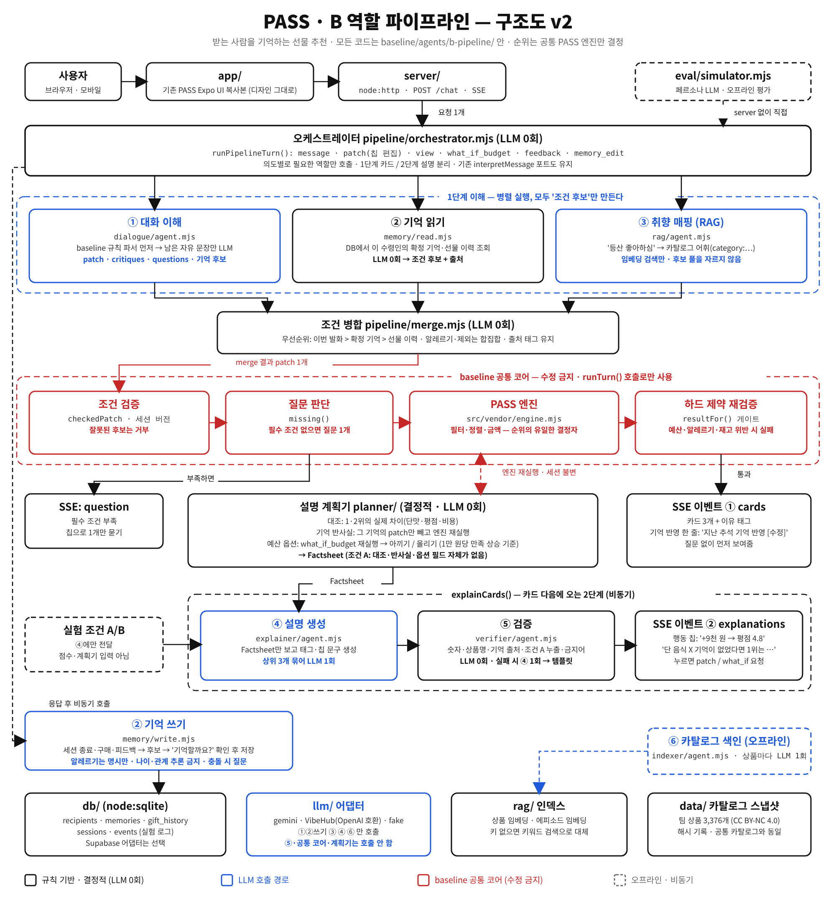

# 역할 파이프라인 작업 공간 (B)

받는 사람을 기억하는 선물 추천 에이전트. 대화 이해 · 기억 · 취향 매핑 · 설명 생성 · 검증 역할을 나누고, 순위는 공통 PASS 엔진만 결정한다.



- 무엇을 만드는가: [docs/PRD.md](docs/PRD.md)
- 어떻게 만드는가: [docs/TRD.md](docs/TRD.md)
- 결정 기록·팀 요청: [docs/decisions.md](docs/decisions.md)
- Claude Code 실행 순서: [docs/KICKOFF.md](docs/KICKOFF.md)

## 현재 상태
P6까지 구현: 기억 저장·읽기, 대화 이해, 취향 매핑, 오케스트레이터(`pipeline/index.mjs` `createPipeline`), 설명 계획기, 검증·설명 생성, 서버(`server/`), 앱 복사본(`app/`). 진행은 [docs/PLAN.md](docs/PLAN.md).

**P7부터 방향 전환:** main 프로토타입 챗봇(6beb5af)을 `proto/`에 복사해 기반으로 쓰고, 에이전트는 그 앞뒤에 끼운다. [docs/PROTO-REBASE.md](docs/PROTO-REBASE.md)

### LLM 키가 없을 때
- 규칙(`parseRules`)으로 풀리는 문장만 처리된다. 예: "어머니 한 세트 세트당 예산 5만원 이하 배송비 포함 추천".
- **S1("엄마는 단 거 싫어하시고 땅콩 알레르기, 아빠는 등산 좋아하셔…")은 키 없이 불가하다.** 질문 "받는 분과 예산을 조금 더 구체적으로 알려주세요."로 끝난다(R9).
- S2의 "부모님 설 선물 추천해줘"는 키 없이 풀린다. 행사 단어(설·추석·생일·스승의 날 등)를 먼저 떼어 `occasion`으로 넣고 나머지를 규칙으로 처리한다(K33).
- 테스트(`node --test`) 중에는 키가 환경에 있어도 LLM을 만들지 않는다(K23).

### 실제 LLM 설정 (기본: 학교 DeepSeek, OpenAI 호환 · K72)
- `.env`: `LLM_BASE_URL=https://llm.ai.hy.miwork.ai/v1`, `LLM_API_KEY=`(키는 `.env`·서버 secret에만), `LLM_MODEL=deepseek-v4-flash`, `LLM_REASONING=off`(기본, 본문에 `reasoning:{enabled:false}`; `on`이면 필드를 뺌). `LLM_PROVIDER`는 비워 두면 `LLM_API_KEY`로 openai-compatible이 된다.
- ① 대화 이해(`llmTurn`, 기억 후보 포함)·④ 설명이 같은 클라이언트(`llm/openai-compatible.mjs`)를 쓴다. `response_format: json_object` + 프롬프트 속 스키마, 받은 값은 검증 후 실패하면 규칙·템플릿으로 폴백. `reasoning_content`는 읽지 않는다.
- 서버가 `reasoning` 필드를 거부하면 재시도하지 않고 `[llm] role=dialogue code=llm_config detail="reasoning"`이 찍힌다 → `LLM_REASONING=on`으로 바꾼다.
- Gemini로 되돌리기: `LLM_PROVIDER=gemini` + `GEMINI_API_KEY`·`GEMINI_MODEL`(아래).
- 3턴 실측: `node --env-file=.env scripts/llm-turns.mjs` (실제 호출, reasoning off/on 각각).

### Gemini 설정 (`LLM_PROVIDER=gemini`일 때)
- `GEMINI_MODEL`은 `-latest` 별칭 대신 **버전 이름**을 쓴다(별칭은 모델이 바뀌어 지연·응답 형식이 달라질 수 있다). 예: `gemini-3.5-flash-lite`.
- 대화 이해 호출의 타임아웃은 `DIALOGUE_LLM_TIMEOUT_MS`(기본 8000). 시간 초과면 사용자에게 "잠시 후 다시 보내 주세요."가 나가고, 그 밖의 실패는 위 질문으로 끝난다.
- 요청에는 응답 스키마(`responseJsonSchema`)가 들어가고 생각(thinking)은 끈다. 끌 수 없는 모델이 HTTP 400을 돌려주면 그 설정 없이 한 번 다시 보낸다.
- LLM 호출이 실패하면 서버 터미널에 한 줄이 찍힌다: `[llm] role=dialogue code=llm_schema detail="$ missing recipients"`. 이유 코드와 스키마 필드 이름만 나오고 키·원문은 없다.
- 실제 키로 한 번 측정: `node --env-file=.env scripts/llm-smoke.mjs ["문장"]` (실제 호출, 시간·patch 출력).
- 규칙으로 먼저 풀리는 짧은 답: "2세트·2개", "개당", "배송비 포함해서", "네"(같은 상품 질문에 대한 답)는 LLM 없이 처리한다(`dialogue/short-answers.mjs`).

## 계약 (변경 없음)
- `index.mjs`: `interpretMessage({text,state}) → {patch, questions, unresolved}`, `createAgent({interpret})`
- 전체 파이프라인은 별도 진입점 `pipeline/index.mjs`의 `createPipeline(deps)`로 추가한다.

```sh
# 이 폴더 기준
npm run test:all     # 공통 + b-pipeline 테스트
npm run check:scope  # 커밋 전 범위 확인
npm run demo
```

브랜치: `codex/architecture-b-pipeline`. 공통 규칙은 [상위 안내](../README.md)와 [AGENTS.md](../AGENTS.md)를 따른다.

## 서버와 앱 실행 (로컬 실험 전용, 인증 없음)
```sh
npm run dev:server                    # http://127.0.0.1:8787 (HOST, PORT, PIPELINE_DB_PATH, CORS_ORIGIN, LLM 키는 환경 변수)
npm run latency                       # AC16 규칙 경로 측정 (LLM 경로는 --llm, 승인 후)
cd app && EXPO_PUBLIC_PIPELINE_URL=http://127.0.0.1:8787 npx expo start --web   # 앱 의존성은 app/에서 먼저 npm install
```
- `EXPO_PUBLIC_PIPELINE_URL`이 있으면 앱이 파이프라인 모드가 된다(참가자 ID 입력 → 서버와 SSE). 없으면 기존 mobile/과 같은 동작이다.
- 실험 조건은 진행자가 `EXPO_PUBLIC_PIPELINE_EXPERIMENT=A|B`(기본 B)로 정한다. 화면에는 조건 이름이 나오지 않는다.
- 폰에서 접속하려면 서버를 `HOST=0.0.0.0`으로 띄우고 같은 네트워크 주소(예: `http://192.168.0.12:8787`)를 쓴다. 앱은 HTTPS가 아니면 사설망 주소만 받는다.
- 앱 서비스 계층: `app/src/services/pipelineChatService.ts`(전송)와 `pipelineEvents.mjs`(순수 로직, `tests/app-service.test.mjs`). 새 UI: `app/src/PipelineExtras.tsx`.
