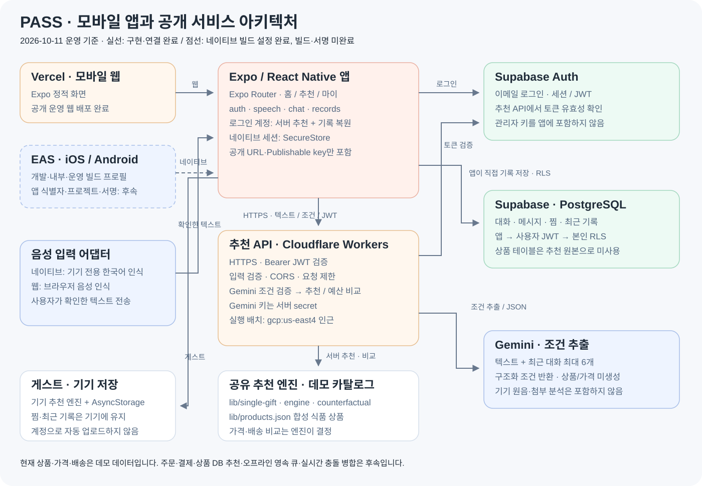
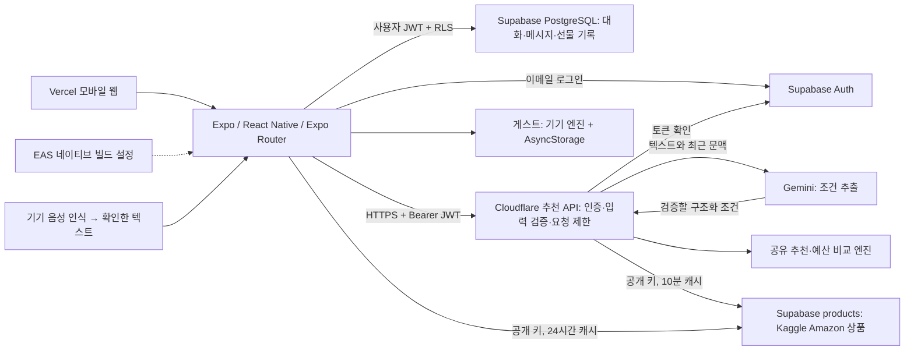

# PASS 운영 아키텍처

2026-10-11 구현·운영 배포 기준입니다.

[공개 구조도](https://temporary-prompt-sable-s15js3l.vercel.app/architecture.svg) · [웹 앱](https://temporary-prompt-sable-s15js3l.vercel.app)

## 실제 경로

1. 웹은 Vercel에서 정적 Expo 화면을 제공하고, iOS·Android는 같은 서비스 계층을 사용합니다.
2. 앱은 Supabase Auth로 로그인합니다. 네이티브 세션은 SecureStore, 웹 세션은 SDK 브라우저 저장소에 저장합니다.
3. 로그인 계정의 대화·조건·찜·최근 기록은 앱이 사용자 토큰과 RLS로 DB에 직접 저장합니다. 추천 API가 개인 기록을 대리 저장하지 않습니다.
4. 앱은 확인한 텍스트와 최근 대화 최대 6개를 추천 API에 전달합니다. 서버는 Supabase에서 토큰을 검증하고, IP 120회/분·계정 30회/분 제한과 입력 검증을 적용합니다. 제한은 Cloudflare 위치별 집계이며 전역 비용 상한이 아닙니다.
5. Gemini는 조건만 추출합니다. 상품 선택·금액·예산 비교는 공유 엔진이 결정합니다. 상품 원본은 Supabase `products`(Kaggle Amazon Products Dataset, CC BY-NC 4.0)이며 Worker는 10분, 앱은 24시간 캐시합니다. 알레르기는 상품명 키워드 추정이라 앱이 성분표 확인 안내를 함께 표시합니다.
6. 게스트는 기기 추천과 AsyncStorage를 사용합니다. 게스트 기록은 로그인 계정에 자동 업로드하지 않습니다. 네이티브 음성은 기기 전용 인식이며, 웹 음성은 브라우저 인식 서비스로 전송될 수 있습니다.

## 배포 설정

| 대상 | 설정 위치 | 상태 |
| --- | --- | --- |
| Vercel 웹 | `vercel.json` + production 공개 환경 변수 3개 | 운영 배포 완료 |
| Cloudflare API | `api/wrangler.jsonc` + `GEMINI_API_KEY` secret | 운영 배포 완료; `gcp:us-east4` 인근 배치 |
| 로컬 앱 | `mobile/.env.local` | 공개 API·Supabase 값 반영 |
| EAS 네이티브 빌드 | `mobile/eas.json` | development/preview/production 프로필과 공개 값 반영; 클라우드 빌드 미실행 |

`EXPO_PUBLIC_` 값은 앱 번들에서 읽을 수 있는 공개 설정입니다. Gemini 키·Supabase 관리자 키는 앱과 Git에 포함하지 않습니다. EAS preview/development도 현재 동일한 운영 Supabase 프로젝트와 API를 사용하며 독립 테스트 환경은 아닙니다.

네이티브 배포에는 Expo 계정·EAS 프로젝트 연결, Android package / iOS bundle identifier와 서명 설정이 남아 있습니다. 실제 앱스토어 배포나 OTA 업데이트는 구성하지 않았습니다. 구매·결제·배송, 상품 DB 기반 추천, 실시간 충돌 병합, 영속 오프라인 큐도 후속 작업입니다.

공식 문서: [EAS 빌드 프로필](https://docs.expo.dev/build/eas-json/), [EAS 환경 변수](https://docs.expo.dev/eas/environment-variables/).
