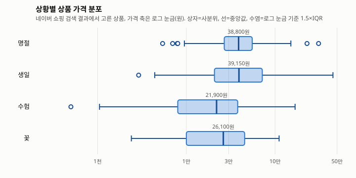
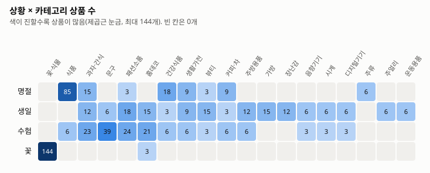

# 한국 선물 상품 카탈로그 수집 보고서

생성 2026-11-13 · 시드 v1.2 · 카테고리 매핑 v1 · `scripts/catalog/web/report.mjs`로 재생성

## 1. 수집 개요

- **출처:** 네이버 쇼핑 검색 결과 첫 페이지(`search.shopping.naver.com/ns/search`, 기본 랭킹순). 상세 페이지·리뷰 본문·판매자 정보는 수집하지 않았다.
- **방식:** 사람이 Chrome 시크릿 창에서 검색 결과를 열고 "웹페이지, 전체"로 저장(로그인 없음). 자동 수집(Playwright, 창 표시 모드, 요청 간격 4~8초)은 파일럿에서 두 사이트 모두 첫 품목에서 차단되어 쓰지 않았다.
- **기간:** 2026-11-13 ~ 2026-11-13
- **규모:** 시드 200개(4개 상황 × 50) → 페이지 200개 → 결과 8,824개 → 선정 600개 → 중복을 합친 상품 590개
- **robots.txt:** 네이버는 HTTP 418 오류 페이지만 돌아와 **신뢰할 수 없음**. 조교의 크롤링 허락이 사이트 약관을 대신하지는 않는다.
- **시드 변경:** 식용유 선물세트 → 카놀라유 선물세트, 쿠키 선물박스 → 쿠키 선물세트, 터치 장갑 → 스마트폰 터치 장갑, 용담 꽃다발 → 가을 꽃다발, 스마트폰 터치 장갑 → 겨울 터치장갑

## 2. 상황별 상품 수와 가격

| 상황 | 상품 수 | 1만 원 미만 | 1~3만 원 | 3~5만 원 | 5~10만 원 | 10만 원 이상 |
|---|---|---|---|---|---|---|
| 명절 | 148 | 9 (6.1%) | 45 (30.4%) | 47 (31.8%) | 35 (23.6%) | 12 (8.1%) |
| 생일 | 150 | 18 (12.0%) | 39 (26.0%) | 40 (26.7%) | 31 (20.7%) | 22 (14.7%) |
| 수험 | 149 | 47 (31.5%) | 48 (32.2%) | 32 (21.5%) | 17 (11.4%) | 5 (3.4%) |
| 꽃 | 147 | 36 (24.5%) | 45 (30.6%) | 38 (25.9%) | 24 (16.3%) | 4 (2.7%) |

| 상황 | n | 최저 | 1사분위 | 중앙값 | 3사분위 | 최고 |
|---|---|---|---|---|---|---|
| 명절 | 148 | 5,400원 | 26,738원 | 38,800원 | 55,225원 | 309,000원 |
| 생일 | 150 | 2,900원 | 20,725원 | 39,150원 | 71,750원 | 449,000원 |
| 수험 | 149 | 500원 | 8,000원 | 21,900원 | 37,900원 | 168,000원 |
| 꽃 | 147 | 2,400원 | 10,000원 | 26,100원 | 45,400원 | 111,000원 |

## 3. 카테고리 분포

| 카테고리 | 명절 | 생일 | 수험 | 꽃 | 전체 |
|---|---|---|---|---|---|
| 꽃·식물 (flower) |  |  |  | 144 | 144 |
| 식품 (food) | 85 |  | 6 |  | 91 |
| 과자·간식 (snack) | 15 | 12 | 23 |  | 49 |
| 문구 (stationery) |  | 6 | 39 |  | 45 |
| 패션소품 (accessory) | 3 | 18 | 24 |  | 44 |
| 홈데코 (decor) |  | 15 | 21 | 3 | 39 |
| 건강식품 (health) | 18 | 3 | 6 |  | 25 |
| 생활가전 (personal_care) | 9 | 9 | 6 |  | 24 |
| 뷰티 (beauty) | 3 | 15 | 3 |  | 21 |
| 커피·차 (coffee_tea) | 9 | 3 | 6 |  | 18 |
| 주방용품 (kitchen) |  | 12 | 6 |  | 18 |
| 가방 (bag) |  | 15 |  |  | 15 |
| 장난감 (toy) |  | 12 |  |  | 12 |
| 음향기기 (audio) |  | 6 | 3 |  | 9 |
| 시계 (watch) |  | 6 | 3 |  | 9 |
| 디지털기기 (digital) |  | 6 | 3 |  | 9 |
| 주류 (liquor) | 6 |  |  |  | 6 |
| 주얼리 (jewelry) |  | 6 |  |  | 6 |
| 운동용품 (fitness) |  | 6 |  |  | 6 |

꽃 세부 유형: bouquet 57, preserved 44, bulb 6, pot 37

## 4. 중복과 필드 보유율

- 상황 간 중복(같은 상품이 두 상황 이상): **4개** — 명절+수험 2, 생일+수험 2
- 리뷰 수 보유: 570/590 (96.6%)
- 배송비(목록 기본 배송비) 보유: 590/590, 그중 유료 282개. 조건부 무료배송 기준 금액은 목록에 없어 전부 null
- 선물세트 규칙: 157개 true, 0개 false(규칙 완화)
- 주류: 6개, 모두 명절 태그만

## 5. 선정 과정에서 제외된 결과

| 사유 | 건수 |
|---|---|
| 광고 | 1454 |
| 관련성(핵심어 없음·금지어) | 835 |
| 가격 이상치 | 386 |
| 선물세트 아님 | 89 |
| 가격대 밖(50만 원 초과) | 10 |
| 품절 | 1 |

## 6. 아마존(Kaggle) 카탈로그와 비교

전체 중앙값: 아마존 19,200원(n=3376, 루피 환산값) · 네이버 31,350원(n=590, 실제 원화)

| 카테고리 | 아마존 n | 아마존 중앙값 | 네이버 n | 네이버 중앙값 |
|---|---|---|---|---|
| 장난감 | 137 | 17,600원 | 12 | 29,550원 |
| 홈데코 | 218 | 12,050원 | 39 | 31,200원 |
| 식품 | 131 | 9,200원 | 91 | 40,900원 |
| 가방 | 356 | 20,100원 | 15 | 48,000원 |
| 주방용품 | 184 | 19,200원 | 18 | 33,100원 |
| 생활가전 | 72 | 15,600원 | 24 | 40,550원 |
| 커피·차 | 157 | 10,900원 | 18 | 27,750원 |
| 운동용품 | 244 | 21,100원 | 6 | 47,700원 |
| 패션소품 | 159 | 102,200원 | 44 | 23,650원 |
| 건강식품 | 194 | 21,000원 | 25 | 44,900원 |
| 과자·간식 | 222 | 10,550원 | 49 | 21,800원 |
| 뷰티 | 284 | 29,200원 | 21 | 32,000원 |
| 메이크업 | 228 | 15,850원 | 0 | - |
| 시계 | 207 | 72,800원 | 9 | 15,000원 |
| 주얼리 | 195 | 9,000원 | 6 | 88,900원 |
| 음향기기 | 388 | 117,250원 | 9 | 55,800원 |
| 꽃·식물 | 0 | - | 144 | 25,725원 |
| 문구 | 0 | - | 45 | 7,800원 |
| 디지털기기 | 0 | - | 9 | 129,000원 |
| 주류 | 0 | - | 6 | 47,500원 |

## 7. 논문 데이터 파트 재료

- **수집:** 2026-11-13~2026-11-13, 네이버 쇼핑 검색 결과 첫 페이지, 수동 저장 200페이지.
- **품목 선정:** 상황(명절·생일·수험·꽃)마다 서로 다른 품목 50개를 시드로 정했다(`v1.2`).
- **상품 선정 규칙:** 광고·가격 없음·품절 제외 → 제목에 핵심어 필요(꽃다발·화분 같은 일반어 제외, 이표기 허용)와 금지어 제외 → 품목별 가격 중앙값의 0.2배 미만·5배 초과 제외 → 서로 다른 가격대에서 순위가 가장 높은 상품부터 품목당 3개 → 같은 판매처·브랜드 1개, 같은 상품 중복 제거. "…선물세트" 품목은 선물세트 표기 상품을 우선.
- **합성·대체 필드:** 도착일은 규칙 합성(배송 배지 1일, 생화 꽃다발 1일, 신선식품 2일, 그 밖 2~3일). 인기도는 검색 시점의 누적 리뷰 수. 배송비는 목록의 기본 배송비로, 지역 추가 요금과 조건부 무료는 반영하지 않았다. 알레르기는 상품명 키워드 추정이다.
- **한계:** 검색 랭킹(광고 제외)에 의존하고 랭킹 알고리즘은 공개되지 않았다. 가격·리뷰 수는 수집 시점 값이다. 브랜드 필드가 없어 판매처 기준으로만 다양성을 맞췄다. robots.txt를 확인할 수 없었고, 허락이 약관을 대신하지 않는다. 상품 이미지는 표시하지 않는다.
